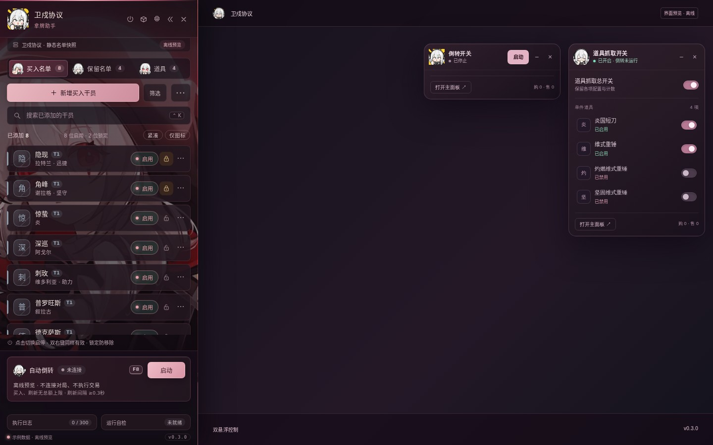
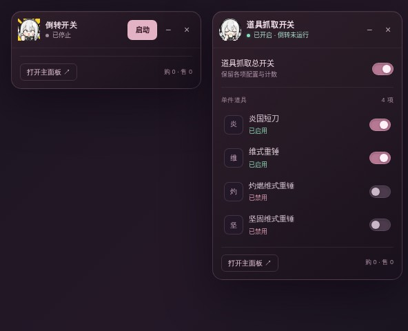

# 卫戍协议 · 拿牌助手

**把名单、倒转和道具抓取放到顺手的位置。**

面向卫戍协议网页版的浏览器扩展。通过侧边工作台管理买入与保留名单，用两个独立悬浮窗控制自动倒转和道具抓取。

> 不会打开网页就自动交易。自动买卖与刷新仅在手动启动后运行。

## 界面展示



*离线界面预览，使用示例名单与道具，不是真实对局截图。*



*两个悬浮窗可分别拖动、收起、关闭，并各自记忆位置。关闭浮窗不会停止运行或改变抓取配置。*

## 主要功能

| 功能 | 说明 |
| --- | --- |
| 买入名单 | 添加目标干员，搜索、筛选，逐项启用或禁用 |
| 保留名单 | 按当前持有量补足目标，支持数量与资金门槛 |
| 自动倒转 | 手动启动与停止，按方案执行买入、出售和刷新 |
| 道具抓取 | 设置抓取上限、持有目标、资金门槛与自动使用规则 |
| 双悬浮窗 | 倒转启停与道具抓取分开控制，互不占用同一个窗口 |
| 图标布局 | 支持图标模式、拖动排序和位置记忆 |
| 本地配置 | 支持方案导入、导出与备份恢复 |

道具抓取总开关只控制抓取配置，不会替你启动倒转。达到限制的道具不会因快捷操作被悄悄清零或重新启用。

## 安装

适用于支持 Manifest V3 的 Chromium 浏览器，如 Chrome、Edge。

1. 点击仓库右上方 **Code → Download ZIP**，下载并解压；或执行：
   ```bash
   git clone https://github.com/Sharky-shark-Blue/stronghold-card-helper.git
   ```
2. 打开扩展管理页：Chrome 使用 `chrome://extensions/`，Edge 使用 `edge://extensions/`。
3. 开启 **开发者模式**，选择 **加载已解压的扩展程序**。
4. 选择包含 `manifest.json` 的项目目录。
5. 打开兼容的卫戍协议网页，点击浏览器工具栏中的扩展图标。

仓库包含已构建文件，下载安装不需要先运行 npm 命令。

## 使用

1. 在侧边工作台添加买入目标、保留目标和需要抓取的道具。
2. 检查各项启用状态、数量限制与资金门槛。
3. 点击标题栏的电源图标打开 **倒转开关窗**，箱子图标打开 **道具抓取窗**。
4. 确认方案后，手动启动自动倒转；需要结束自动操作时点击 **停止**。

- 拖动各悬浮窗的标题区域，可分别调整位置。
- 收起或关闭悬浮窗只影响显示，不等于停止自动倒转。
- 道具总暂停不会删除单件设置或清空累计次数。
- 更新扩展后，请在扩展管理页点击重新加载，再刷新游戏页。

## 本地构建

需要 **Node.js 20 或更高版本**。项目使用原生 JavaScript，构建不需要安装第三方运行时依赖。

```bash
npm run build
```

该命令生成 `content-script.js`、`runtime-main.js` 与 `ui-preview.html`。直接打开 `ui-preview.html` 可查看离线界面；预览不会连接游戏或发送交易操作。

```text
src/                 界面、模型与运行控制逻辑
src/engine/          交易、道具、审计与安全保护模块
styles/             界面样式
data/               静态目录数据
test/               开发检查脚本
docs/images/        README 展示图
manifest.json       浏览器扩展入口
build.mjs           构建脚本
```

## 权限与数据

- `activeTab`、`scripting`：在用户主动打开扩展后读取当前网页，并注入工作台。
- `storage`：保存本地配置、布局和运行保护状态。
- 游戏请求由当前游戏页面及其接口处理；本项目不要求填写账号密码。
- 导出配置或日志前，请自行检查其中是否包含不希望公开的信息。

## 使用须知

本项目为非官方辅助工具，与游戏官方无关联。网页结构和游戏规则更新可能导致功能失效；使用前请了解游戏服务条款，自行判断自动化操作是否被允许。

自动操作涉及游戏资源，请先核对方案。遇到交易结果不确定、锁或关键持久化失败等情况，工具设计为停止自动操作，等待用户确认；这不构成对所有异常场景的保证。

展示图仅说明界面布局，不代表已完成实机兼容性验证。

## 授权

本仓库**未提供开源许可证**。公开代码不表示授予使用、修改、分发或商业使用的许可；如需授权，请联系仓库所有者。依法享有的权利及平台条款不受此声明影响。

第三方代码、图像与依赖的权利归各自权利人所有，详见 [第三方声明](THIRD-PARTY-NOTICES.md)。
